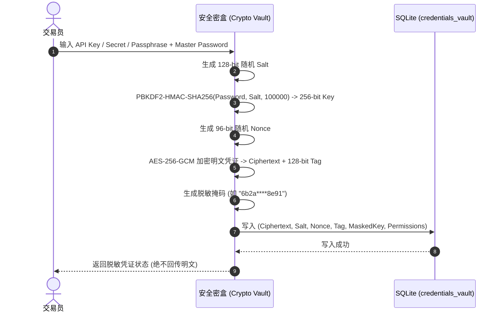
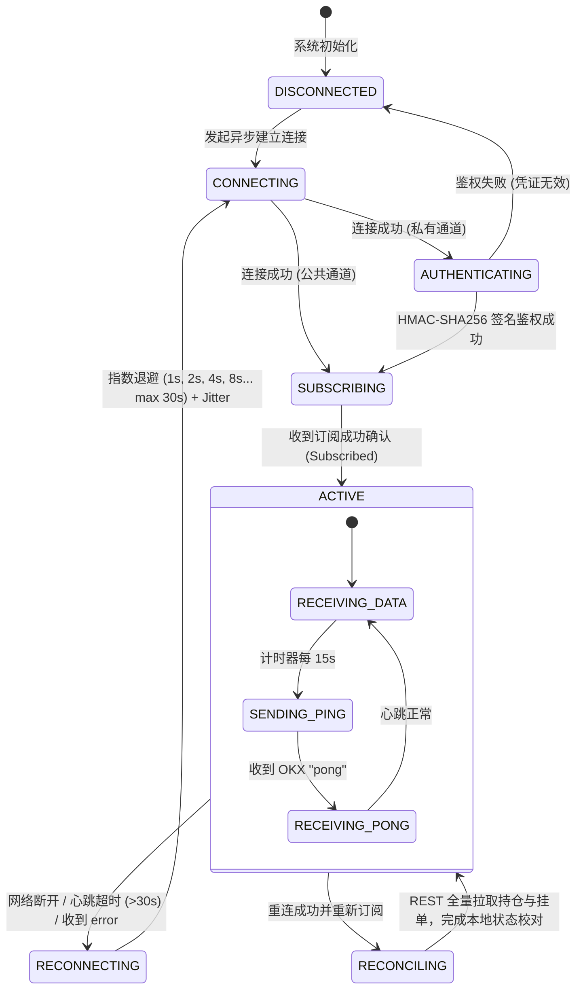
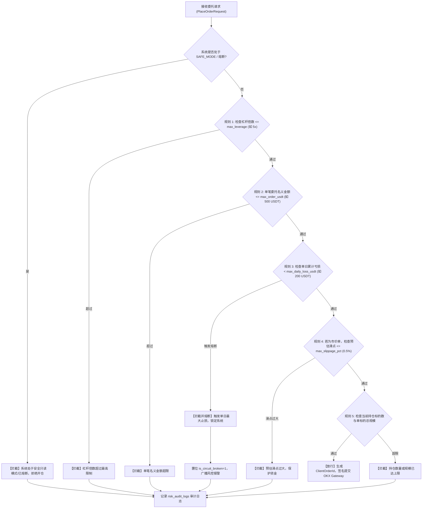
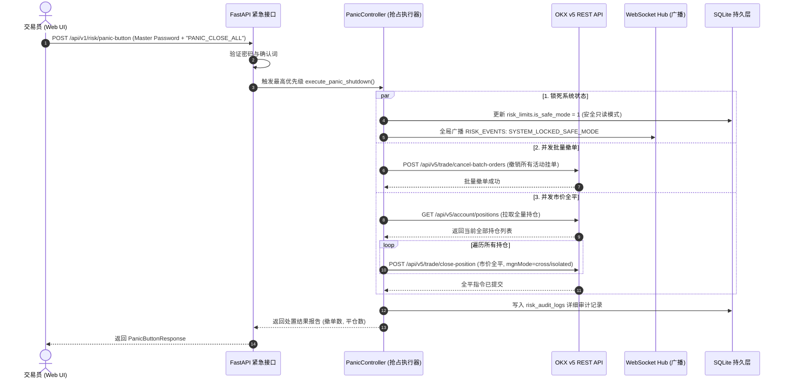
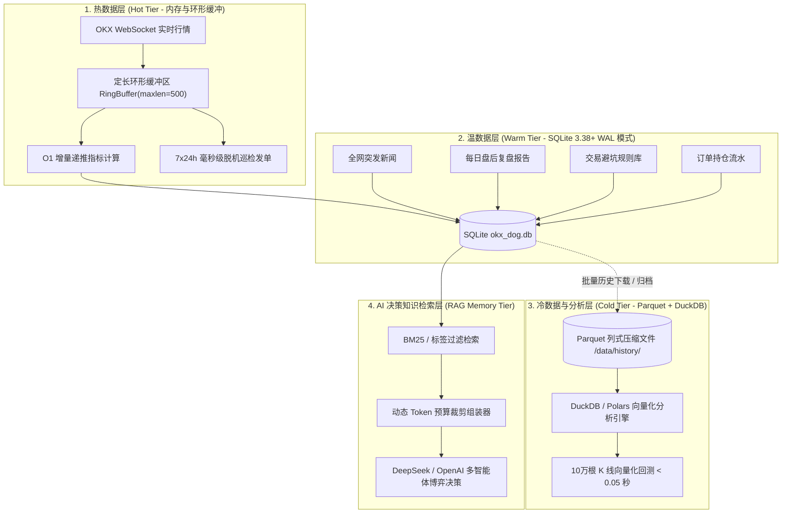
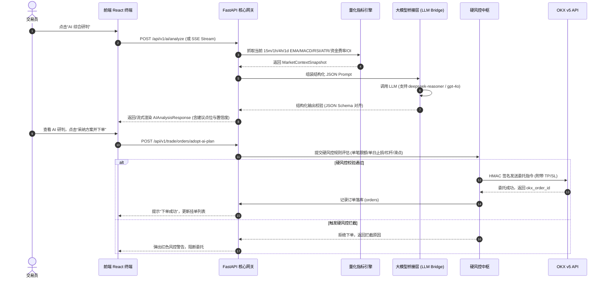
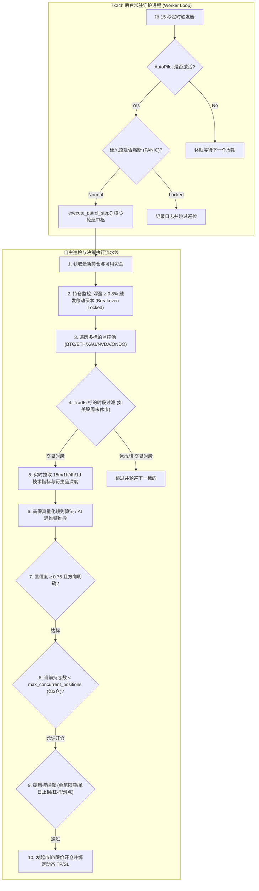

# OKX-Dog 后端核心网关与硬风控系统架构设计规范 (Backend Architecture Specification)

| 文档版本 | 编写日期 | 架构角色 | 技术栈 | 适用范围 |
| :--- | :--- | :--- | :--- | :--- |
| **v1.0.0** | 2026-08-15 | 后端架构师 (`agency-backend-architect`) | Python 3.10+ / FastAPI / Asyncio / SQLAlchemy / aiosqlite / Cryptography | 核心服务端设计与实现 |

---

## 1. 系统总体架构与分层设计

### 1.1 架构设计理念
OKX-Dog 后端作为整个交易系统的“核心大脑与安全中枢”，承担着**毫秒级行情流处理、多周期量化指标计算、大模型智能研判桥接、高可用订单管理与不可绕过的金融级硬风控拦截**等核心职责。
系统遵循以下五大架构红线：
1. **安全第一 (Security-First)**：敏感凭据（API Key / Secret / Passphrase / LLM Key）在本地数据库使用 **AES-256-GCM** 加密，密钥经由交易员主密码派生；物理隔离并严禁提现权限；日志与传输链路全面脱敏。
2. **硬风控绝对不可绕过 (Hard Risk Lock)**：所有订单（无论来源于交易员手动、AI建议一键采纳、还是全自动策略）在流入 OKX Gateway 前，必须同步通过内存状态机与数据库双重硬风控校验。
3. **极低延迟与异步高并发 (Async Event-Driven)**：全链路基于 Python 3.10+ `asyncio` 事件循环构建，利用 FastAPI 异步框架与 WebSocket 连接池，确保行情转发延迟 $< 50\text{ms}$。
4. **弹性与自愈性 (Resilience & Self-Healing)**：OKX v5 WebSocket 具备心跳守护与指数退避重连；重连后自动触发全量状态校对（State Reconciliation）；具备本地令牌桶 API 限频保护。
5. **轻量免运维单文件持久化 (Zero-Maintenance Storage)**：采用 SQLite + WAL 模式 + SQLAlchemy 异步连接池，保证单机私有化部署的极致轻量与高可靠事务。

---

### 1.2 系统分层架构图 (System Layering Architecture)

```mermaid
graph TD
    subgraph ClientLayer ["1. 前端接入与传输层 (Client & Transport Layer)"]
        UI["Web 控制台 (React 18 / Zustand)"]
        HTTP_CLIENT["HTTP REST Client"]
        WS_CLIENT["WebSocket Client"]
        SSE_CLIENT["SSE EventStream Client"]
        UI --> HTTP_CLIENT
        UI --> WS_CLIENT
        UI --> SSE_CLIENT
    end

    subgraph GatewayLayer ["2. API 网关与分发中枢 (API Gateway & Dispatcher)"]
        FASTAPI["FastAPI 异步核心网关 (Uvicorn)"]
        AUTH_MW["JWT 鉴权 & Master-Password 验证中间件"]
        RATE_LIMITER["本地请求速率限制器 (Token Bucket)"]
        WS_HUB["WebSocket 分发 Hub (Connection Pool)"]
        
        HTTP_CLIENT --> AUTH_MW --> FASTAPI
        SSE_CLIENT --> AUTH_MW --> FASTAPI
        WS_CLIENT --> WS_HUB
    end

    subgraph ServiceLayer ["3. 核心业务服务层 (Core Domain Services)"]
        VAULT["安全密盒服务 (AES-256-GCM Vault)"]
        RISK_ENGINE["多重硬风控拦截中枢 (Risk Controller)"]
        ORDER_MGR["订单生命周期管理器 (Order Manager)"]
        POS_MGR["持仓与强平监控服务 (Position Monitor)"]
        INDICATOR_ENG["量化指标计算引擎 (Indicator Engine)"]
        AI_BRIDGE["OpenAI 标准大模型桥接层 (LLM Bridge)"]
        PANIC_CONTROLLER["Panic Button 紧急平仓控制器"]
        
        FASTAPI --> VAULT
        FASTAPI --> ORDER_MGR
        FASTAPI --> AI_BRIDGE
        FASTAPI --> PANIC_CONTROLLER
        ORDER_MGR --> RISK_ENGINE
        PANIC_CONTROLLER --> ORDER_MGR
    end

    subgraph IntegrationLayer ["4. 外部协议集成层 (External Integration Gateways)"]
        OKX_WS["OKX v5 WebSocket 异步长连接器 (Public/Private)"]
        OKX_REST["OKX v5 REST 签名客户端 (HMAC-SHA256)"]
        LLM_CLIENT["OpenAI 兼容 HTTP/SSE 客户端"]
        
        RISK_ENGINE -. 校验通过 .-> OKX_REST
        PANIC_CONTROLLER ==>|高优先级抢占| OKX_REST
        OKX_WS --> INDICATOR_ENG
        OKX_WS --> POS_MGR
        OKX_WS --> WS_HUB
        AI_BRIDGE --> LLM_CLIENT
    end

    subgraph PersistenceLayer ["5. 存储与审计持久层 (Storage & Audit Layer)"]
        SQLITE_DB[("SQLite 3 (WAL Mode)")"]
        ASYNC_ENGINE["SQLAlchemy 2.0 Async Engine (aiosqlite)"]
        
        VAULT <--> ASYNC_ENGINE
        ORDER_MGR <--> ASYNC_ENGINE
        POS_MGR <--> ASYNC_ENGINE
        RISK_ENGINE <--> ASYNC_ENGINE
        AI_BRIDGE <--> ASYNC_ENGINE
        ASYNC_ENGINE <--> SQLITE_DB
    end
```

---

## 2. 金融级安全架构 (Security-First Vault)

### 2.1 AES-256-GCM 凭证密盒设计
为了彻底杜绝 API Key、Secret、Passphrase 以及大模型 Key 泄露的风险，系统采用 **AES-256-GCM**（Galois/Counter Mode）对称加密算法。GCM 模式同时提供保密性与消息完整性认证（AEAD），能有效抵御密文篡改与重放攻击。

#### 密钥派生体系 (Key Derivation Function - PBKDF2)
1. **主密码 (Master Password)**：由交易员在首次配置或启动时输入，不在数据库中持久化。
2. **加盐哈希**：为每个凭证生成 128-bit 密码学安全随机 Salt。
3. **派生算法**：采用 `PBKDF2-HMAC-SHA256`，迭代次数设定为 **100,000 次**，派生出 256-bit 密钥 ($K_{enc}$)。
4. **随机 Nonce/IV**：每次加密生成唯一的 96-bit 随机 IV。
5. **认证 Tag**：生成 128-bit 认证标签 Tag，解密时若 Tag 校验失败，立即拒绝并抛出凭证被篡改异常。



### 2.2 提现权限物理隔离与强安全阻断
系统在首次配置或每次调用 `POST /api/v1/vault/test-connection` 时，向 OKX 发起 `/api/v5/account/config` 权限查询：
* **只读/交易权限 (`read`, `trade`)**：系统允许正常加载。
* **提现权限 (`withdraw`)**：若发现 API Key 开启了提现权限，系统将：
  1. 将 `credentials_vault.has_withdraw_permission` 标记为 `1`。
  2. 立即将系统状态置为 `FATAL_LOCKED`，拒绝启动任何实盘交易。
  3. 在 `risk_audit_logs` 记录 `UNAUTHORIZED_WITHDRAWAL_ATTEMPT` 严重安全事件。
  4. 向前端弹窗发出强警报，要求用户立即在 OKX 官网删除该 Key 并重新创建无提现权限的专用交易 Key。

---

## 3. OKX v5 连接器与网络健壮性 (Gateway & Resilience)

### 3.1 WebSocket 异步长连接管理与订阅架构
OKX v5 WebSocket 分为公共行情通道（Public）与私有业务通道（Private）：
* **公共通道 (`/ws/v5/public` / `/ws/v5/business`)**：监听 `tickers`, `books5`, `candle15m/1h/4h/1d`, `funding-rate`, `open-interest`。
* **私有通道 (`/ws/v5/private`)**：监听 `account`, `positions`, `orders`。



### 3.2 速率限制器 (Rate Limiter)
OKX REST API 对各个端点实施严格限频（例如下单限频 60次/2秒，撤单限频 60次/2秒，通用查询 20次/2秒）。
后端实现基于 **令牌桶 (Token Bucket)** 与 **滑动窗口** 的异步限频器：
1. **客户端预拦截**：在请求发送前获取令牌，若令牌耗尽，协程异步等待 `await asyncio.sleep(retry_after)`，避免触发 HTTP 429。
2. **上游 429 退避**：若收到 OKX `429 Too Many Requests`，自动解析 `Retry-After` 头，执行指数退避重试（最大重试 3 次）。

---

## 4. 多重硬风控拦截中枢 (Risk Controller)

### 4.1 硬风控拦截全景
硬风控是 OKX-Dog 的核心保护壁垒。所有来自 Web 交易面板、一键采纳 AI 研判、或自动策略的委托请求，**必须**同步进入 `RiskController.evaluate_order()` 校验。风控规则以代码硬编码方式保障执行，不提供任何“跳过校验”的 API 参数。



### 4.2 硬风控五重规则详述
1. **单笔下单限额 (`max_order_usdt`)**：
   $$\text{Notional Value} = \text{Price} \times \text{Size} \times \text{ContractMultiplier}$$
   若 $\text{Notional Value} > \text{max\_order\_usdt}$，立即拦截。
2. **单日亏损硬熔断 (`max_daily_loss_usdt`)**：
   $$\text{Daily Loss} = \sum \text{Realized PnL (Today)} + \sum \min(0, \text{Unrealized PnL})$$
   当 $\text{Daily Loss} \ge \text{max\_daily\_loss\_usdt}$ 时：
   - 自动将 `risk_limits.is_circuit_broken` 置为 `1`。
   - 立即向 OKX 发送批量撤销该标的所有活动挂单。
   - 必须由交易员在前端输入主密码手动调用 `/api/v1/risk/reset-circuit-breaker` 才能解除。
3. **最大杠杆倍数硬锁 (`max_leverage`)**：
   任何传入的杠杆参数强制受限 $\le \text{max\_leverage}$（默认 5x），即使 OKX 账户支持 100x 也绝不下发高杠杆指令。
4. **滑点保护算法 (`max_slippage_pct`)**：
   针对市价开平仓单，后端先读取最新盘口深度（OrderBook Depth）：
   $$\text{Slippage} = \frac{|\text{Estimated Fill Price} - \text{Mark Price}|}{\text{Mark Price}} \times 100\%$$
   若 $\text{Slippage} > \text{max\_slippage\_pct}$（默认 0.5%），自动将市价单转换为当前深度第 3 档限价单（IOC）或直接拒绝，杜绝深度不足时的插针流动性损耗。
5. **持仓规模与标的数硬拦截 (`max_open_positions` & `max_position_usdt`)**：
   防止过度分散或过度加仓单一标的。

---

## 5. Panic Button 紧急平仓与安全模式 (Emergency Subsystem)

### 5.1 异步高优先级抢占执行链路
当极端行情出现或系统发生未知异常时，交易员点击前端顶栏的 **Panic Button**。后端开启异步并发熔断处置，链路具备最高调度优先级：



---

## 6. SQLite + SQLAlchemy 异步连接池与持久化设计

### 6.1 存储技术选型与配置
OKX-Dog 采用 **SQLite 3 + SQLAlchemy 2.0 (aiosqlite)** 方案。通过合理的 PRAGMA 调优，SQLite 在单机环境下可轻松实现 $> 50,000\text{ QPS}$ 的读取性能与 $< 5\text{ms}$ 的事务写入延迟。

#### 关键 PRAGMA 配置指令：
```sql
-- 开启 WAL (Write-Ahead Logging) 模式：实现读写并发隔离，读操作不阻塞写，写操作不阻塞读
PRAGMA journal_mode = WAL;

-- 事务同步级别设为 NORMAL：在 WAL 模式下兼顾掉电安全性与极致 I/O 吞吐
PRAGMA synchronous = NORMAL;

-- 设置 64MB 内存页面缓存
PRAGMA cache_size = -64000;

-- 临时表与中间结果存放在内存中
PRAGMA temp_store = MEMORY;

-- 设置忙等待超时时间为 5000ms，避免并发写冲突时抛出 "database is locked"
PRAGMA busy_timeout = 5000;

-- 强制启用外键完整性约束检查
PRAGMA foreign_keys = ON;
```

### 6.2 异步连接池与事务隔离设计
* **引擎配置**：使用 `create_async_engine("sqlite+aiosqlite:///okx_dog.db", pool_pre_ping=True, pool_size=10, max_overflow=20)`。
* **读写分离控制**：
  * **高频行情快照 (`market_snapshots`)**：采用批量写入缓冲区（Batch Buffer），每 1 秒或累计 50 条统一异步批量 Flush 落库，减少磁盘 I/O。
  * **订单与持仓 (`orders`, `positions`)**：采用严格的异步事务 `async with async_session.begin():` 确保 ACID 一致性。

### 6.3 时序冷热分层与分析回测存储架构 (Tiered Hybrid Storage)
为解决海量历史数据存储导致的磁盘膨胀与分析卡顿，系统在架构上明确冷热分层体系：



#### 关键设计原则：
1. **中低频 K 线无膨胀保证**：10 个标的 3 年的 15m/1h/4h/1d K 线仅约 150 万行，在 SQLite 中占用 $< 150\text{MB}$，在 Parquet 中压缩至 $< 30\text{MB}$。
2. **严禁原始毫秒级 Raw Ticks 落盘**：原始毫秒高频数据在内存环形队列中聚合降采样为分钟级特征（如 VWAP、资金费率、大单买卖比）后再持久化。
3. **极速向量化分析 (DuckDB + Parquet)**：策略回测与多周期特征挖掘由嵌入式 DuckDB 零拷贝读取本地 Parquet，10 万根 K 线的均线与收益率向量化计算耗时 $< 20\text{ms}$。
4. **AI 动态 Token 预算 (P0~P3 裁剪)**：Prompt 仅注入 P0 关键指标与 P2 避坑规则（从知识库检索召回），单次 LLM 上下文严格限制在 $800 \sim 1,200$ Tokens。

---

## 7. 模块协同与端到端核心数据流向

### 7.1 AI 研判生成与一键采纳下单端到端流程



---

## 8. 7x24h 后端脱机常驻自主巡检与移动保本引擎架构

### 8.1 架构设计背景与浏览器解耦
为保证量化操盘在交易员离线、电脑关机或网络断开时仍然全天候 7x24h 闭环运行，后端在 FastAPI Lifespan 生命周期中挂载了独立的后台守护协程 `auto_pilot_worker_loop()`，彻底解耦对前端浏览器存活的依赖。



### 8.2 动态移动保本 (Dynamic Breakeven Locked)
1. **触发条件**：
   - 启用 `trailing_stop_enabled=True`；
   - 多头持仓浮盈比率 $(P_{mark} - P_{entry}) / P_{entry} \ge 0.8\%$；
   - 空头持仓浮盈比率 $(P_{entry} - P_{mark}) / P_{entry} \ge 0.8\%$；
2. **执行动作**：
   - 将该持仓的止损价强制上移至开仓均价 $P_{entry}$（或略高于手续费成本位）；
   - 在内存与数据库中标记 `_breakeven_applied_positions`，防止重复提交；
   - 记录风控审计日志，并在前端看板点亮 `Breakeven Locked` 徽章。

### 8.3 组合级持仓敞口控制 (Portfolio Risk Budgeting)
- **多标的池**：支持在 `symbols` 列表中配置加密与 TradFi 多品类资产；
- **并发持仓上限**：`max_concurrent_positions` 限制系统同时持有的最大标的数（默认 3 仓），防止多标的同向波动导致组合爆仓；
- **资金占用预算**：单笔开仓资金不超过可用保证金的 $15\%$，且受硬风控 `max_order_usdt` 绝对值双重钳制。

---

## 9. 总结与部署规范

本架构设计规范已全面涵盖 OKX-Dog 后端系统的分层体系、安全密盒、网络长连接管理、硬风控中枢、7x24h 脱机常驻巡检守护协程、移动保本引擎以及高性能 SQLite 持久化方案。
* 所有接口契约已与 `okx-dog-backend/API_SPEC.md` 完全对应；
* 所有数据实体已与 `okx-dog-backend/models.py` 及 `DATABASE_SCHEMA.sql` 保持一致；
* 为前端 TypeScript 接口（`TYPES_CONTRACT.ts`）与 AI 模块（`AI_SCHEMA.json`）提供了标准的后端数据契约支持。
